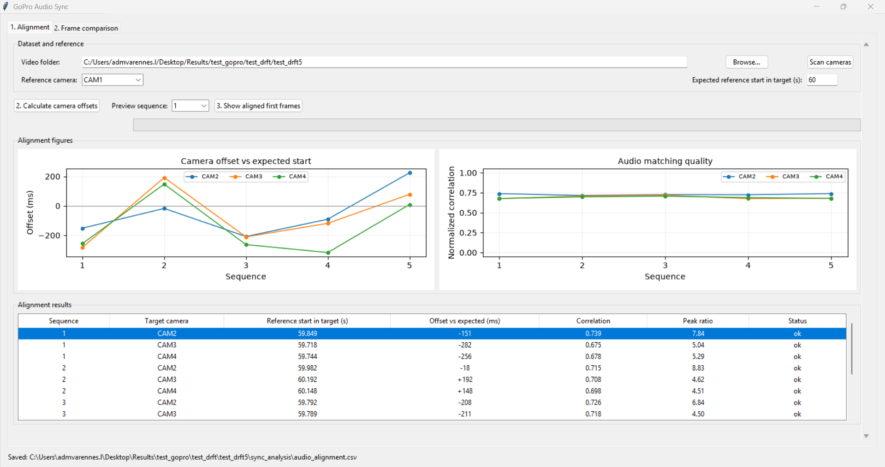
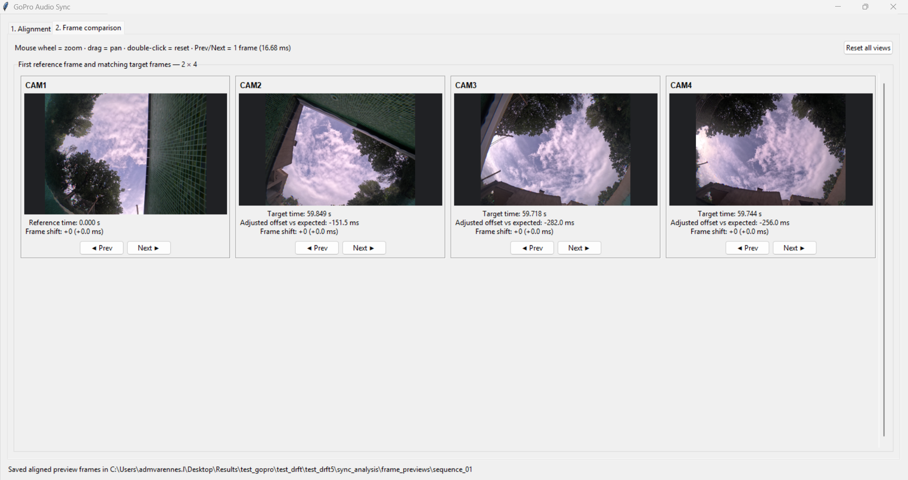
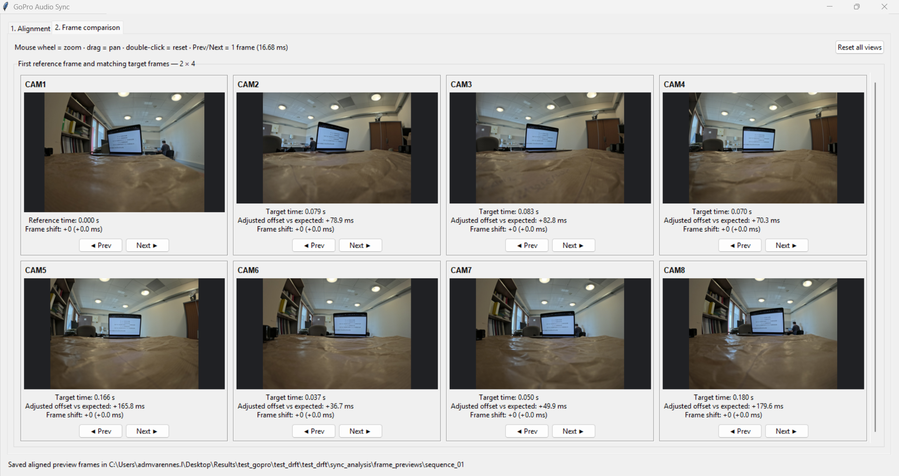
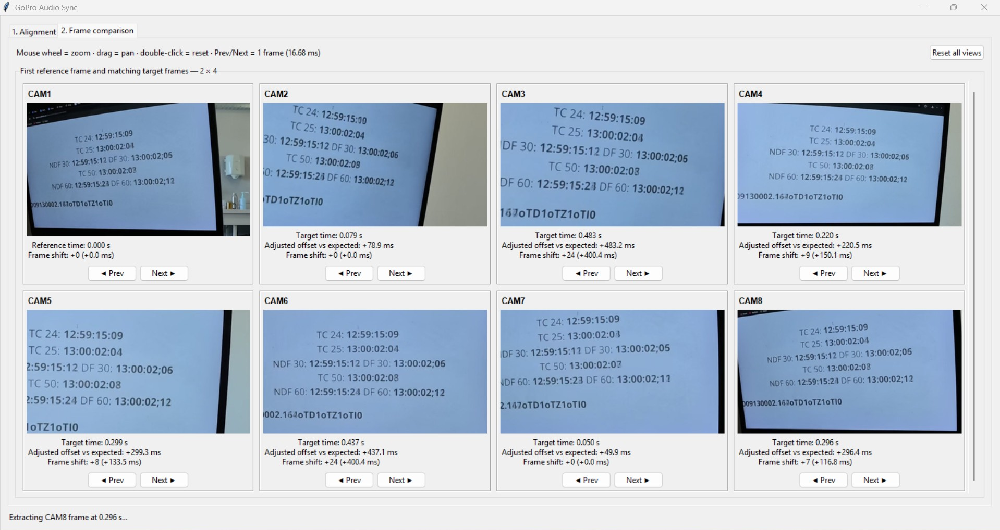

# Synchronization GUI

| Current retained solution | Why |
|---|---|
| **Audio-based offset estimation + optional frame-by-frame visual verification** | Audio cross-correlation provides a fast first estimate for every sequence. When a common visual event or clock is visible, the estimate can be checked and refined directly in video frames. |

??? note "What the software does not assume"

    The application does **not** assume that one fixed offset or one linear drift coefficient is valid for an entire experiment. NemoReefRecord timing tests showed that inter-camera offsets can vary between acquisition sequences.

The synchronization GUI was developed to measure the relative temporal offset between GoPro recordings without modifying the original MP4 files.


!!! info "Source code"
    The GoPro synchronization GUI is available on GitHub:

    [NemoReefRecord-GoProSync](https://github.com/ANR-BrAInVR/NemoReefRecord-GoProSync){ target="_blank" rel="noopener" }

The workflow is intentionally two-stage:

1. **audio alignment** proposes an offset from the recorded soundtrack;
2. **frame comparison** allows the user to verify or refine that estimate visually.

At 59.94 fps:

```text
1 frame = 1001 / 60000 s = 16.683 ms
```

## Audio alignment

The reference-camera audio is searched inside each target-camera audio track using **normalized cross-correlation**.

```text
reference audio
      ↓
WAV extraction + preprocessing
      ↓
normalized cross-correlation
      ↓
maximum correlation position
      ↓
match_time
      ↓
offset = match_time - expected_start_time
```

For every sequence, the GUI reports:

- estimated reference position in the target recording;
- offset relative to the expected start time;
- normalized correlation score;
- peak ratio;
- matching status.

It also displays summary figures before the detailed result table so that sequence-to-sequence variation is immediately visible.



### Underwater example — `test_drft5`

In `test_drft5`, four cameras were recorded underwater. CAM1 had a shorter acquisition window and emitted characteristic acoustic markers. This makes the reference signal easier to identify inside the longer target recordings, and the resulting audio offsets are considered reasonably reliable.

The limitation is that this dataset does **not** contain a strong common visual timing reference, so frame-level confirmation from the images alone is difficult.



## Frame comparison

After audio alignment, the corresponding video frames are shown side by side.

For each camera, the user can:

- **zoom** with the mouse wheel;
- **pan** the image by dragging;
- reset the view with a double-click;
- move independently to the **previous or next frame**;
- read the updated temporal correction in milliseconds and frames.

This makes the GUI useful even when the automatic audio estimate is imperfect.

### Eight-camera visual-clock example

The 9 October test is particularly useful because all eight cameras see the **same external DF60 time display**. The common visual signal provides an independent way to evaluate the automatic audio estimate.



In this dataset, the automatic audio estimate is visibly less reliable than in the dedicated acoustic-marker experiments. The frame-comparison interface nevertheless makes the residual offset easy to measure directly from the common clock signal.



!!! warning "Why audio cross-correlation is weaker in this dataset"
    Several differences make the 9 October recording less favorable for the current algorithm:

    - recordings were made **in open air** rather than underwater;
    - all cameras used the **same recording duration and instructions**;
    - there was no shorter reference-camera recording embedded in longer target recordings;
    - there were no characteristic start/stop beep sequences acting as strong acoustic landmarks.

    The current cross-correlation workflow was developed around the dedicated-marker protocol. In recordings without those landmarks, its result should be treated as a **first estimate**, not as ground truth.

!!! success "Practical role of the GUI"
    The software combines two complementary measurements: an automatic audio estimate and, when possible, a direct frame-level visual check. A common flash, clock, movement or other shared visual event can therefore be used to refine the alignment even when audio matching is ambiguous.

## Typical workflow

1. Select the experiment folder containing `CAM1`, `CAM2`, …
2. Choose a reference camera.
3. Enter the expected reference position in the target recording.
4. Calculate camera offsets.
5. Inspect the offset and correlation figures.
6. Select a sequence and open **Frame comparison**.
7. Zoom or pan the images if required.
8. Use **Prev / Next** to refine each camera one frame at a time.

??? note "Generated files"

    The application creates:

    ```text
    sync_analysis/
    ├── audio_alignment.csv
    ├── audio_wav/
    └── frame_previews/
    ```

    Manual `Prev` / `Next` adjustments are used for visual verification and refinement. They do not overwrite the original automatic measurement stored in `audio_alignment.csv`.

## From measured offsets to synchronized videos

The final objective is to generate videos sharing the **same physical frame origin**.

CAM1 defines the reference timeline and is not trimmed at its acoustic marker. For each target camera, the start of the video is trimmed so that the same marker occurs at the same frame index as in CAM1.

```text
trim_frames_camera = marker_frame_camera - marker_frame_CAM1
```

At 60 fps, final alignment is performed in **video frames**, not only in audio seconds.

??? note "Example"

    If the CAM1 marker occurs at frame `180`, and the same marker occurs at:

    ```text
    CAM2 = 3660
    CAM3 = 3638
    CAM4 = 3651
    ```

    then:

    ```text
    CAM2: 3480 frames
    CAM3: 3458 frames
    CAM4: 3471 frames
    ```

    After trimming, the marker occurs at frame `180` in every output video.

!!! info "Current status"
    Offset measurement and visual verification are operational. Generation and final frame-level validation of synchronized output videos remain the next validation step.
