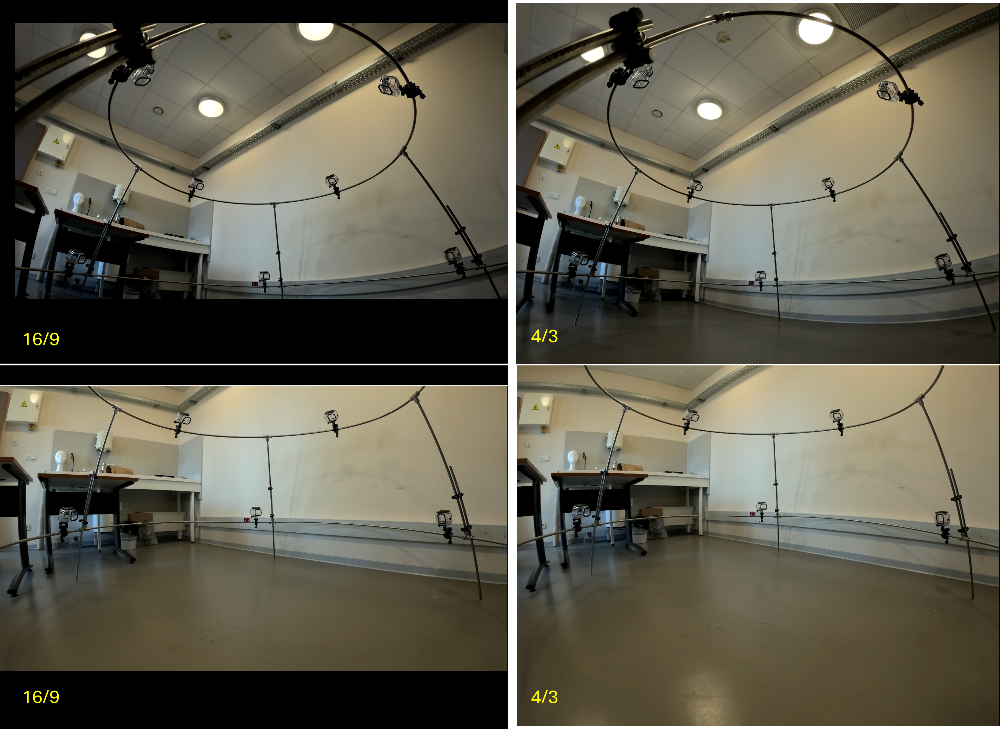
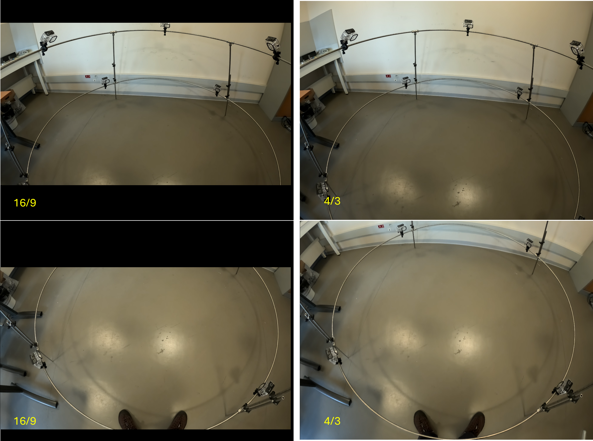

# Field-of-View Tests

| Current retained solution | Why |
|---|---|
| **4K 4:3, 60 fps, Wide** | The 4:3 format provides the extra vertical coverage required by the NemoReefRecord geometry without changing the camera structure. |

??? note "Other options tested"

    | Option | Why it was not retained |
    |---|---|
    | 4K 16:9 | Less vertical coverage for both the lower and upper camera rings. |
    | Changing the physical camera geometry | Not required once 4:3 provided sufficient additional coverage. |

!!! info "What this test revealed"
    The limiting factor was **vertical field of view**, not horizontal image resolution. This directly motivated the switch to **4:3**.

Field-of-view tests compared **16:9** and **4:3** recording formats for the NemoReefRecord camera geometry.

## Lower camera ring

The **4:3 format provides greater vertical coverage**, which is particularly useful for cameras observing the recording volume from the side.

## Upper camera ring

For the upper cameras, **4:3 increases the visible area around the acquisition volume** while maintaining coverage of the central region.

## Selected format

| Parameter | Setting |
|---|---|
| Resolution | **4K** |
| Aspect ratio | **4:3** |
| Frame rate | **60 fps** |
| Lens | **Wide** |
| Bit depth | **8-bit** |
| Stabilization | **OFF** |

!!! success "Selected configuration"
    **4K 4:3 at 60 fps** is the current NemoReefRecord recording format.
