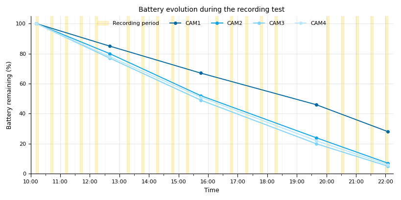
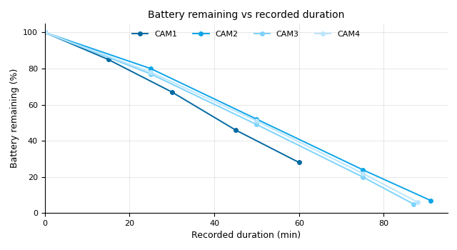
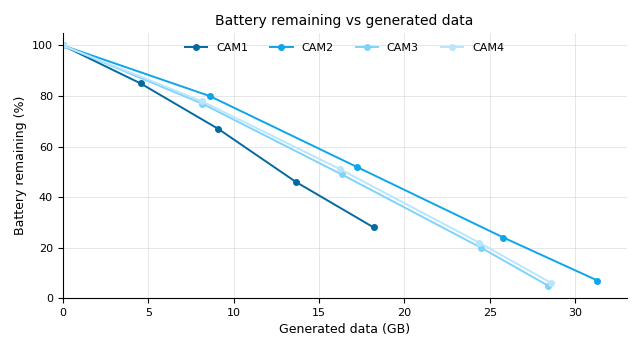

# Recording & Battery Tests

| Current retained solution | Why |
|---|---|
| **4K 4:3, 60 fps, 8-bit, stabilization OFF** with short scheduled recording windows | Avoids the thermal issues observed with long 10-bit recordings and provides substantially better autonomy for repeated experimental sessions. |

??? note "Other options tested"

    | Option | Why it was not retained |
    |---|---|
    | 10-bit with long recording periods | Thermal shutdown and/or early battery depletion were observed. |
    | Long continuous duty cycles | Reduce autonomy and increase thermal load. |
    | Stabilization ON | Not required for the fixed experimental camera geometry and adds processing load. |

!!! info "Main conclusion"
    **Recording duty cycle is the dominant practical constraint.** Short recording windows substantially improve autonomy. The 7 October full-day experiment also showed that cameras may stop recording before the displayed battery reaches 0%.

This page documents recording autonomy, thermal behaviour, battery consumption and generated data volume for the GoPro MISSION 1 cameras used in NemoReefRecord.

## Battery experiment — 7 October 2026

!!! info "What this test revealed"
    Battery consumption closely follows **cumulative recorded duration**. CAM1, which recorded only 3 min per session, retained substantially more battery than CAM2–CAM4, which recorded 5 min per session.

Battery level was monitored throughout four consecutive experimental blocks performed on **7 October 2026**.

- CAM1 recorded **3 min per session**.
- CAM2–CAM4 recorded **5 min per session**.
- The experiment covered three underwater blocks followed by one open-air block.

*Battery remaining throughout the experimental day. Yellow bands indicate the programmed 5 min acquisition windows of CAM2–CAM4; CAM1 recorded for 3 min inside each window.*

### Battery consumption vs effective recording

The shorter CAM1 duty cycle is clearly reflected in both effective recording duration and generated data volume.

*Battery remaining as a function of cumulative recorded duration.*

*Battery remaining as a function of cumulative generated data. Intermediate data volumes are estimated from final generated volume and cumulative recorded duration.*

Across the measurements collected during the experiment, cumulative recorded duration was strongly associated with battery consumption (**r ≈ 0.994**). Generated data volume showed a similarly strong association (**r ≈ 0.981**).

These relationships are descriptive rather than causal because elapsed time, recorded duration and generated data volume all increase during the experiment.

### Low-battery shutdown

!!! warning "What this test revealed"
    CAM2–CAM4 did not all complete the final open-air block, even though the cameras displayed approximately **5–7% battery after reboot**. A few percent of displayed battery should therefore not be considered a safe operating margin.

The final open-air experiment could not be completed by all cameras because of low battery.

This experiment does **not** establish a precise MISSION 1 shutdown threshold. The battery percentage displayed after restarting should not be interpreted as the exact level at which recording stopped.

??? note "Detailed data — 7 October 2026"

    #### Battery evolution

    | Time | CAM1 battery | CAM2 | CAM3 | CAM4 | CAM1 recorded | CAM2 | CAM3 | CAM4 |
    |---|---:|---:|---:|---:|---:|---:|---:|---:|
    | 10:11 | 100% | 100% | 100% | 100% | 0 min | 0 min | 0 min | 0 min |
    | 12:40 | 85% | 80% | 77% | 78% | 15 min | 25 min | 25 min | 25 min |
    | 15:45 | 67% | 52% | 49% | 51% | 30 min | 50 min | 50 min | 50 min |
    | 19:39 | 46% | 24% | 20% | 22% | 45 min | 75 min | 75 min | 75 min |
    | 22:05 | 28% | 7% | 5% | 6% | 60 min | 91 min | 87 min | 88 min |

    #### End-of-day results

    | Camera | Recorded duration | Battery remaining | Battery used | Generated data |
    |---|---:|---:|---:|---:|
    | CAM1 | 60 min | 28% | 72% | 18.2 GB |
    | CAM2 | 91 min | 7% | 93% | 31.3 GB |
    | CAM3 | 87 min | 5% | 95% | 28.4 GB |
    | CAM4 | 88 min | 6% | 94% | 28.6 GB |

    #### Final open-air block

    | Camera | Sessions recorded |
    |---|---:|
    | CAM1 | **5 / 5** |
    | CAM2 | **4 / 5** |
    | CAM3 | **3 / 5** |
    | CAM4 | **3 / 5** |

    CAM1 recorded substantially less video because its sequences lasted only **3 min**, compared with **5 min** for CAM2–CAM4. This difference is reflected in both battery remaining and generated data volume at the end of the day.

## Initial recording tests

!!! info "What these tests revealed"
    Long **10-bit** recording periods can end in thermal shutdown or probable battery depletion, whereas the selected **8-bit / stabilization OFF** configuration gives more repeatable autonomy.

Earlier tests were used to identify a practical recording configuration before the full-day 7 October experiment.

| Test | Configuration | Cycle | Total recorded video | Main observation |
|---|---|---|---:|---|
| **24–25/09** | **8-bit, stabilization OFF** | **5 min REC / 35 min pause** | **≈ 45 min** | 9/24 sequences; ~8.0 GB |
| **24/09** | **8-bit, stabilization OFF** | **5 min REC / 15 min pause** | **≈ 1 h 30 min** | 18/24 sequences; ~21.8 GB |
| **23/09 pm** | **8-bit, stabilization OFF** | **10 min REC / 10 min pause** | **≈ 1 h 52 min** | 11 complete sequences + ~2 min; ~47 GB |
| **23/09 am** | **8-bit, stabilization OFF** | **10 min REC / 10 min pause** | **≈ 1 h 52 min** | 11 complete sequences + ~2 min; ~48.5 GB |
| **22/09 pm** | **10-bit** | **20 min REC / 1 min pause** | **≈ 1 h 39 min** | Probable battery depletion |
| **22/09 am** | **10-bit** | **20 min REC / 1 min pause** | **1 h 14 min 51 s** | Thermal shutdown |

The two tests performed with **8-bit / stabilization OFF / 10 min REC / 10 min pause** both provided approximately **1 h 52 min of recorded video**, showing consistent autonomy across repeated tests.

The earlier 10-bit tests with long recording periods resulted in either probable battery depletion or thermal shutdown.

These observations contributed to the current recording configuration:

- **4K 4:3**
- **60 fps**
- **8-bit**
- **stabilization OFF**
- **GPS OFF**
- **wireless OFF**

!!! tip "Wi-Fi / iPhone setup"
    During Wi-Fi / iPhone configuration, **do not connect the GoPro to external power**.

## Next steps

Further autonomy tests will evaluate:

- battery consumption during the final NemoReefRecord duty cycle;
- autonomy over a complete field deployment;
- variability between cameras;
- influence of underwater operation on autonomy;
- relationship between recording duration, generated data volume and battery consumption.
