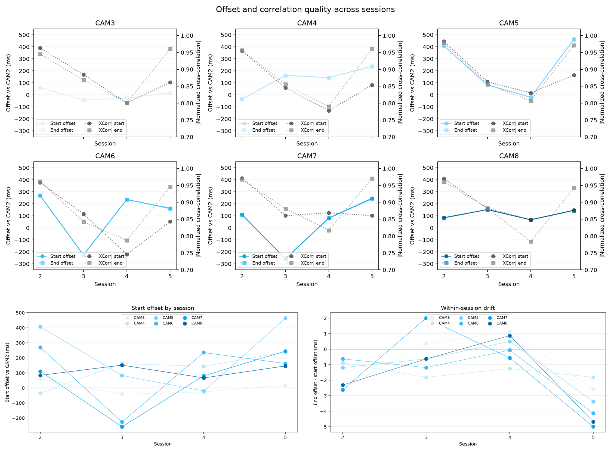
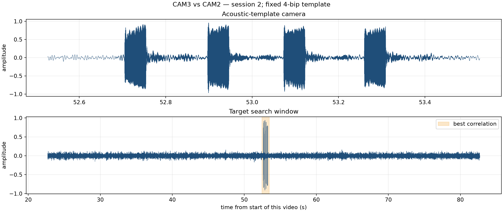
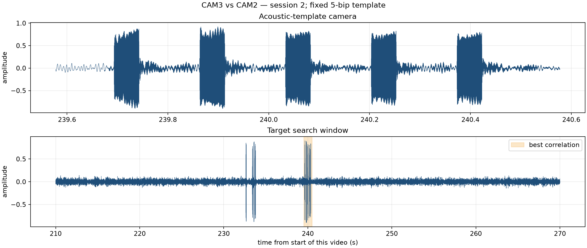
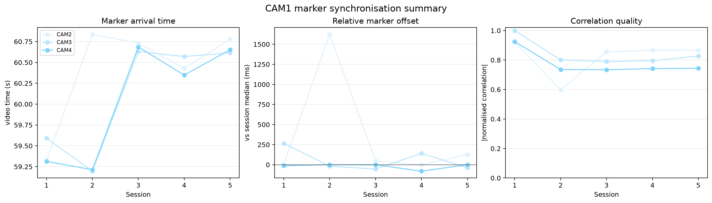
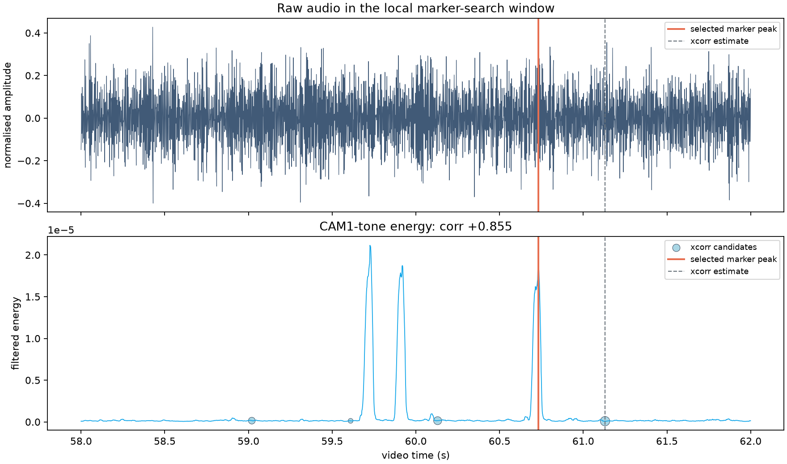
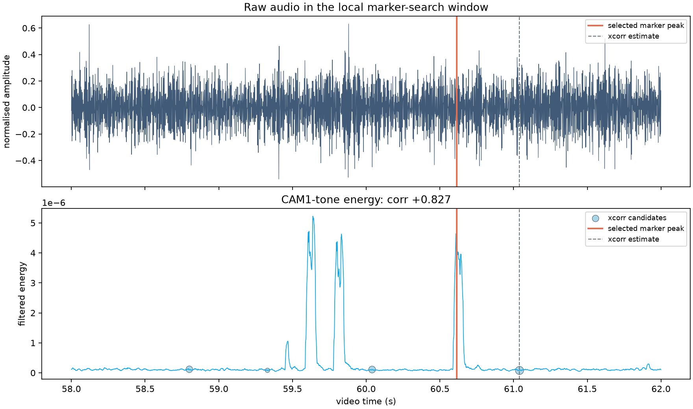
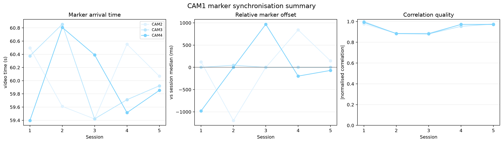
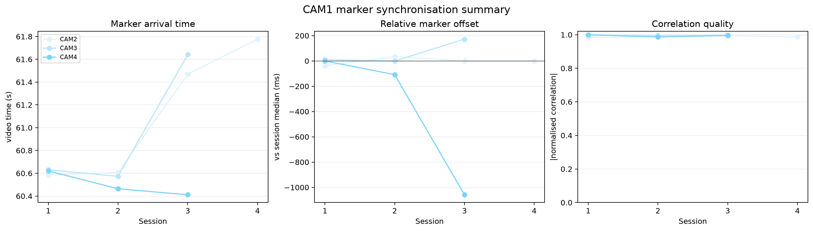
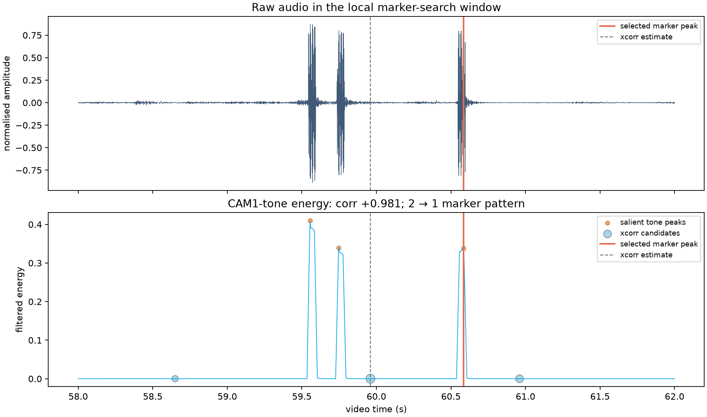
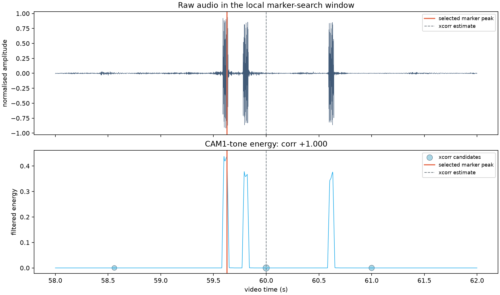

# Camera Synchronization Tests

| Current retained solution | Why |
|---|---|
| **Absolute scheduling + independent per-session synchronization measurement** | Precision Time alone does not keep the cameras aligned to the same frame, and the measured offsets are not consistently linear enough to predict with one correction per camera. Each sequence must therefore be measured independently. |

??? note "Other synchronization options tested"

    | Option | Why it is not sufficient alone |
    |---|---|
    | Precision Time only | Camera offsets remain several frames to several hundred milliseconds apart and are not consistently linear over time. |
    | One fixed offset per camera | Sequence-to-sequence offsets change too much. |
    | One linear drift coefficient per camera | Several cameras show large deviations from a simple linear model. |
    | Scheduled start times only | Absolute scheduling prevents cumulative schedule drift but does not guarantee frame-level simultaneous starts. |
    | Relative recording loops | Processing delays accumulate between sequences. |

!!! success "Current synchronization strategy"
    Use **Precision Time to initialize the camera clocks**, **absolute times to schedule each recording window**, then measure the actual offset of every camera **for every sequence**. Audio markers provide the primary temporal reference; a dedicated software tool can additionally verify the result visually when a common landmark is visible.

The tests below separate three different timing questions: **clock accuracy**, **inter-camera start offset**, and **within-recording stability**.

!!! warning "Main result at this stage"
    The cameras are **not frame-aligned**, and the measured offsets are not described by a stable linear drift model. Across the 9 October test, inter-camera timing differences reach **several frames to several hundred milliseconds**, while some cameras change direction or deviate strongly from a straight-line trend.

    For NemoReefRecord this is the unfavorable case: the offset cannot yet be predicted reliably from one constant or one drift coefficient per camera. **Each sequence must therefore be measured independently.**

| What we observe | Consequence |
|---|---|
| Inter-camera offsets are larger than one 60 fps frame (~16.7 ms) | Precision Time alone is insufficient for frame-level synchronization. |
| Offsets change between sessions | A fixed per-camera correction is insufficient. |
| Several cameras show non-linear residuals of ~8–10 frames | A simple linear drift correction is also insufficient. |
| Within-sequence acoustic drift can remain much smaller | Once a sequence is aligned, timing can be stable enough for frame-level work. |

## 1. Multi-camera timing stability — 9 October 2026

### Precision Time stability test

!!! warning "What this test revealed"
    Precision Time did **not** produce frame-stable multi-camera synchronization. More importantly, the residual errors were **not consistently linear**, which prevents a simple per-camera drift correction from reliably solving the problem.

Eight cameras were synchronized using Precision Time and programmed to record at **13:00, 14:00 and 15:00**. For the first frame of every recording, two timestamps were compared:

- camera `TMCD`, converted to civil time using `60000/1001 = 59.94006 fps`;
- an external **DF60 civil-time display** visible in the image, with its final frame field converted as `FF / 60`.

!!! info "TMCD reminder"
    `TMCD` is the **timecode embedded in the GoPro video file**. It represents the camera's internal clock as `HH:MM:SS:FF`, where `FF` is a frame number rather than milliseconds. For MISSION 1 recordings, the nominal 60 fps timecode is converted back to civil time using the actual video rate `60000/1001 ≈ 59.94 fps`. Comparing this camera-internal time with the external DF60 reference lets us measure each camera's clock offset and how it evolves between acquisitions.

```text
clock error = external civil time - TMCD civil time
```

Three outcomes matter for NemoReefRecord:

| Possible result | Consequence |
|---|---|
| Cameras remain synchronized | No correction required. |
| Offset/drift is linear and reproducible | Easy post-processing correction per camera. |
| Error is non-linear / sequence-dependent | **Per-session resynchronization required.** |

The present dataset corresponds to the **third case**.

| Scheduled acquisition | First-frame delay, mean ± SD | Range across cameras |
|---|---:|---:|
| 13:00 | **1.960 ± 0.185 s** | 1.700–2.217 s |
| 14:00 | **1.900 ± 0.086 s** | 1.800–2.050 s |
| 15:00 | **1.800 ± 0.174 s** | 1.550–2.083 s |

A linearity check compares the 14:00 measurement with a straight-line interpolation between 13:00 and 15:00. The residual was approximately **−166 ms for CAM2**, **+167 ms for CAM5**, and **−133 ms for CAM7** — around **8–10 frames at 60 fps**.

!!! warning "Decision"
    A fixed offset or a single linear drift coefficient is not reliable enough for the current recordings. **Each acquisition sequence must be measured independently.**

!!! note "DF60 notation"
    The external display uses `HH:MM:SS:FF`, where `FF` is a **frame number at 60 fps**, not milliseconds. To avoid ambiguity, the tables below show the DF60 reading already converted to civil time in `HH:MM:SS.mmm`.

??? note "Detailed measurements — 13:00"

    | Camera | TMCD → civil time | External DF60 → civil time | Start after schedule | External − TMCD |
    |---|---:|---:|---:|---:|
    | CAM1 | `13:00:01.704` | `13:00:02.217` | 2216.7 ms | +512.7 ms |
    | CAM2 | `13:00:01.805` | `13:00:02.117` | 2116.7 ms | +311.7 ms |
    | CAM3 | `13:00:01.671` | `13:00:01.700` | 1700.0 ms | +29.0 ms |
    | CAM4 | `13:00:01.805` | `13:00:01.967` | 1966.7 ms | +161.7 ms |
    | CAM5 | `13:00:01.704` | `13:00:01.900` | 1900.0 ms | +196.0 ms |
    | CAM6 | `13:00:01.704` | `13:00:01.750` | 1750.0 ms | +46.0 ms |
    | CAM7 | `13:00:01.788` | `13:00:02.133` | 2133.3 ms | +345.3 ms |
    | CAM8 | `13:00:01.704` | `13:00:01.900` | 1900.0 ms | +196.0 ms |

??? note "Detailed measurements — 14:00"

    | Camera | TMCD → civil time | External DF60 → civil time | Start after schedule | External − TMCD |
    |---|---:|---:|---:|---:|
    | CAM1 | `14:00:01.801` | `14:00:01.917` | 1916.7 ms | +115.7 ms |
    | CAM2 | `14:00:01.784` | `14:00:01.817` | 1816.7 ms | +32.7 ms |
    | CAM3 | `14:00:01.801` | `14:00:01.967` | 1966.7 ms | +165.7 ms |
    | CAM4 | `14:00:01.818` | `14:00:02.050` | 2050.0 ms | +232.0 ms |
    | CAM5 | `14:00:01.667` | `14:00:01.933` | 1933.3 ms | +266.3 ms |
    | CAM6 | `14:00:01.701` | `14:00:01.817` | 1816.7 ms | +115.7 ms |
    | CAM7 | `14:00:01.651` | `14:00:01.800` | 1800.0 ms | +149.0 ms |
    | CAM8 | `14:00:01.651` | `14:00:01.900` | 1900.0 ms | +249.0 ms |

??? note "Detailed measurements — 15:00"

    | Camera | TMCD → civil time | External DF60 → civil time | Start after schedule | External − TMCD |
    |---|---:|---:|---:|---:|
    | CAM1 | `15:00:01.847` | `15:00:01.750` | 1750.0 ms | −97.0 ms |
    | CAM2 | `15:00:01.697` | `15:00:01.783` | 1783.3 ms | +86.3 ms |
    | CAM4 | `15:00:01.814` | `15:00:02.083` | 2083.3 ms | +269.3 ms |
    | CAM5 | `15:00:01.664` | `15:00:01.667` | 1666.7 ms | +2.7 ms |
    | CAM6 | `15:00:01.714` | `15:00:01.833` | 1833.3 ms | +119.3 ms |
    | CAM7 | `15:00:01.714` | `15:00:01.933` | 1933.3 ms | +219.3 ms |
    | CAM8 | `15:00:01.664` | `15:00:01.550` | 1550.0 ms | −114.0 ms |

    CAM3 is missing. The CAM8 value at 15:00 remains the least consistent point during visual verification and should be rechecked.

??? note "Per-camera linearity check"

    | Camera | 13:00 error | 14:00 error | 15:00 error | 14:00 deviation from linear interpolation |
    |---|---:|---:|---:|---:|
    | CAM1 | +512.7 ms | +115.7 ms | −97.0 ms | −92.2 ms |
    | CAM2 | +311.7 ms | +32.7 ms | +86.3 ms | **−166.3 ms** |
    | CAM3 | +29.0 ms | +165.7 ms | — | — |
    | CAM4 | +161.7 ms | +232.0 ms | +269.3 ms | +16.5 ms |
    | CAM5 | +196.0 ms | +266.3 ms | +2.7 ms | **+167.0 ms** |
    | CAM6 | +46.0 ms | +115.7 ms | +119.3 ms | +33.0 ms |
    | CAM7 | +345.3 ms | +149.0 ms | +219.3 ms | **−133.3 ms** |
    | CAM8 | +196.0 ms | +249.0 ms | −114.0 ms | +208.0 ms* |

    `*` CAM8 at 15:00 remains to be rechecked visually.

Independent visual comparison against the external DF60 display confirmed that the observed inter-camera differences are present in the recordings rather than being a timestamp-conversion artefact.

??? note "External synchronization references"

    Two HERO12 experiments were used only as methodological references:

    - [Reddit — Timecode synchronization and drift on GoPro HERO12](https://www.reddit.com/r/gopro/comments/18uxnv0/timecode_synchronization_and_drift_on_gopro_hero12/){ target="_blank" rel="noopener" }
    - [YouTube — GoPro HERO12 timecode synchronization test](https://www.youtube.com/watch?v=Upz1ksiH_lE&t=572s){ target="_blank" rel="noopener" }

    They report very different behaviours, from roughly 233 ms over 90 min to approximately one frame over nearly two hours. They use a different camera model and are not treated as MISSION 1 performance specifications.


## 2. Per-session resynchronization strategy

!!! info "Software used for offset measurement"
    Because the measured inter-camera offsets are larger than one frame and are not consistently linear between sessions, **each acquisition sequence is measured independently**.

    A dedicated desktop application estimates the relative offset from the audio track and provides a frame-by-frame visual verification interface when a common visual event or clock is available.

    See **[Synchronization GUI](../software/synchronization-gui.md)** for the software workflow, cross-correlation method, screenshots, visual refinement tools and generated files.

The synchronization tests below evaluate whether the acoustic markers themselves provide a sufficiently stable temporal reference.

## 3. Acoustic-marker validation

### Open-air relative-loop experiment

!!! success "What this test revealed"
    The **start offset changes substantially between sequences**, but once a sequence has started, relative timing between cameras remained stable to only a few milliseconds. This strongly supports **independent alignment of every sequence** rather than one correction for the whole experiment.

Eight cameras performed five sessions. CAM1 recorded a shorter sequence and generated acoustic start/end markers. Sessions 2–5 produced **48 usable cross-correlations**.

| Camera | Maximum start → stop variation |
|---|---:|
| CAM3 | 2.6 ms |
| CAM4 | 1.8 ms |
| CAM5 | 3.4 ms |
| CAM6 | 4.1 ms |
| CAM7 | **5.0 ms** |
| CAM8 | 4.7 ms |

At 60 fps, one frame is approximately **16.7 ms**. The maximum observed within-sequence change was therefore well below one frame.



??? note "Detection method and examples"

    CAM2 session 2 was used as the template. Start and stop markers were independently detected using short acoustic templates and normalized cross-correlation.

    

    


### Absolute-scheduling tests — underwater and open air

!!! info "What these tests revealed"
    Absolute scheduling removes cumulative schedule drift, but **marker arrival still varies between cameras and sessions**. Open-air audio is very reliable; underwater detection remains usable but requires stronger filtering and validation.

Three datasets were analysed:

| Dataset | Environment | Result |
|---|---|---|
| `test_drft4` | Underwater | Marker detectable; background noise makes automatic selection harder. |
| `test_drft5` | Underwater | Same conclusion; per-session offsets remain measurable. |
| `test_drft6` | Open air | Very strong automatic detections, typically ~0.98–1.00 normalized correlation in the illustrated examples. |

!!! success "Preferred validation dataset"
    `test_drft6` is the preferred dataset for validating the complete synchronized-video generation pipeline because marker detection is clean and unambiguous.

??? note "Underwater figures"

    

    

    

    

??? note "Open-air figures"

    

    

    


## 4. Clock-drift metadata — DRFT / DRFS

!!! info "What this test revealed"
    The absence of `DRFS` after 24–72 h is **not evidence of a failure of DRFT**. GoPro Labs clarified that MISSION only generates `DRFS` when clock error reaches approximately **1 s after 24 h**.

A MISSION 1 was synchronized with a **Precision Time QR code**, `*DRFT=1` was enabled, and the clock was checked again after approximately **72 h**. A similar test was performed with GPS synchronization over approximately **24 h**.

`DRFT 1` was present in metadata, but no `DRFS` value was generated.

Andrew from GoPro Labs clarified that `DRFT` was primarily designed for older cameras with larger clock drift. On MISSION, the clock is expected to be more stable, and `DRFS` is generated only if the accumulated error reaches at least **1 s / 24 h**.

[GoPro Labs Discussion #1830 — MISSION 1 clock drift / DRFT / DRFS](https://github.com/gopro/labs/discussions/1830){ target="_blank" rel="noopener" }

!!! success "Interpretation"
    The internal MISSION 1 clock stayed below the threshold required to generate a `DRFS` correction. This is encouraging for **clock stability**, but it does not demonstrate frame-level synchronization between several cameras.

## Current validation status

| Step | Status |
|---|---|
| Precision Time clock initialization | **Available** |
| Absolute acquisition scheduling | **Retained** |
| Automatic per-session audio offset measurement | **Validated** |
| Open-air acoustic-marker detection | **Validated** |
| Underwater marker detection | **Validated, more challenging** |
| Visual frame-level verification | **Available in synchronization software** |
| Generate trimmed synchronized videos | **Next step** |
| Final frame-level validation of output videos | **Next step** |
